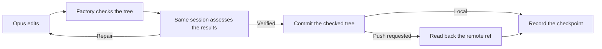

# How Factory works

Factory runs on the developer's machine. The target repository keeps its own instructions, checks and launch tools. Factory carries only the procedures that transfer between projects, so a maintainer never has to keep a second copy of the project's knowledge in sync. The agent chooses what would demonstrate the requested behavior. Factory freezes that decision and records what happened when the check ran.

## Follow one check

1. **Discover.** `factory inspect` walks from the target paths to their repository root. It locates instruction files for the agent to read and extracts command candidates from supported manifests and project-declared checks. Each candidate includes its source and working directory. [Discovery and source identity](../skills/software-factory/scripts/workspace.py)
2. **Freeze.** `factory start` validates the contract and saves the claims under a new run ID. An external Python oracle is copied into the run, so editing the original later cannot weaken the saved expectation. [Contracts and evidence](../skills/software-factory/scripts/evidence.py)
3. **Observe.** `factory check` locks the workspace, fingerprints it, writes a pending attempt and runs the command. It captures output, exit status and timestamps, then fingerprints the workspace again. If the two fingerprints differ, Factory marks the attempt blocked. A temporary edit restored before the second snapshot is invisible to that comparison. [Process supervision](../skills/software-factory/scripts/supervision.py)
4. **Read back.** `factory status` compares the latest attempt for each claim to the current subject and checks the stored log digest. When a review is required, its report must also match the subject. A later outcome is a separate observation about that revision. [Behavioral tests](../tests/test_evidence.py)

In Git, the fingerprint includes HEAD, the index, tracked working files and unignored new files. A staged change still matters if an unstaged edit reverses it. A plain directory uses its filesystem contents. The journal and its digests share the local account's trust boundary. A check can also depend on ignored files, executables from PATH, or a script referenced by `argv`. For a service check, observe which build or account actually answered. [Consumer check guidance](../skills/software-factory/references/local.md#when-a-model-controls-the-outcome)

## Reach agreement between two models

`factory consensus design` asks Codex and Opus to compare alternatives and state what evidence would change their minds. In `diagnosis`, each must connect a proposed cause to the symptom or name the missing observation. A confirmed diagnosis may be inconclusive.

Each participant studies the same evidence before it sees the other's conclusion, which keeps the second opinion independent. The coordinator saves both opening reports, then alternates replies in the original sessions. Each proposal has a numbered turn, and agreement must acknowledge that specific turn. The discussion closes when both participants endorse the same proposal. An exhausted exchange budget produces an unresolved result with the last turn available for inspection. [Dialogue](../skills/software-factory/scripts/dialogue.py)

For example, if a deleted item still appears in a list, one participant might suspect a failed write and the other a stale client cache. A direct read of the stored item and a fresh list response can tell the two apart. Both can agree on that experiment while the cause is still unknown.

## Follow one simplification round

The coordinator pins the task, base, permitted paths, checks and number of rounds. Each round opens a fresh session that starts from the current branch. Its first user message is the exact versioned prompt. Requirements and the branch diff travel in a separate context channel, so you can inspect which prompt actually ran. [Prompt](../skills/software-factory/references/reconsider-from-first-principles.v1.txt)

The assessment resumes the editing session with read-only tools. A failing check requires repair even if the model accepts its work. A round can keep the code as it stands, and the selected number of rounds still runs. [Round coordinator](../skills/software-factory/scripts/rounds.py) · [Provider adapter](../skills/software-factory/scripts/harness.py)

The coordinator journals each phase before contacting a provider, and the harness records the request and session. Recovery uses those records to reconcile an interrupted call. Factory compares the working inputs around each check, before assessment, and before creating a commit. A rewrite hidden by Git normalization still blocks the round. The comparison records symlinks as links. Older rounds without a saved input fingerprint still use the Git tree check. Factory computes the candidate tree with a temporary index and compares it with the tree that gets committed. If the process dies between a commit and its receipt, recovery checks the parent, tree, branch and commit identity. With publication enabled, Factory binds the destination, checks the expected remote head and reads it back after pushing. The explicit lease protects an independently moved remote. [Git checkpoints](../skills/software-factory/scripts/checkpoints.py) · [Recovery and publication tests](../tests/test_rounds.py)

## Boundaries and tradeoffs

| Boundary | Decision and consequence |
| --- | --- |
| Runtime | The CLI and skill ship together and use only Python's standard library. All state is local. Resuming a run needs its saved state and workspace. [Installation](../skills/software-factory/scripts/installation.py) |
| Processes | A supervisor owns the child process group and holds the workspace lock while it cleans up. Invocations on the same worktree share the lock when they use the same state directory. A service that deliberately detaches needs its own lifecycle handling. [Interruption tests](../tests/test_supervision.py) |
| Judgment | The local engine can verify a weak contract perfectly. Independent consumer checks, fresh reviews and later corrections expose different failures. [Live evaluation](../evals/qualify.py) |
| Agreement | Two independent openings reduce anchoring. Agreement records a decision about one proposal and may conclude that the evidence is insufficient. [Dialogue](../skills/software-factory/scripts/dialogue.py) |
| Feedback | A later observation belongs to its original source revision. Changing a shared practice needs a scoped regression case and controls. [Outcome transfer experiment](../evals/outcome_transfer.py) |
