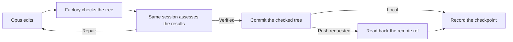

# Architecture

Factory runs on the developer's machine. The target repository supplies its instructions and checks. The agent chooses what would demonstrate the requested behavior. Factory freezes that decision and records what happened when the check ran.

## Follow one check

1. **Discover.** `factory inspect` walks from the target paths to their repository root. It locates applicable instruction files for the agent to read and extracts command candidates from supported manifests and project-declared checks. Each command candidate includes its source and working directory. [Discovery and source identity](../skills/software-factory/scripts/workspace.py)
2. **Freeze.** `factory start` validates the contract and saves the claims under a new run ID. An external Python oracle is copied into the run. Editing the original oracle later cannot weaken the saved expectation. [Contracts and evidence](../skills/software-factory/scripts/evidence.py)
3. **Observe.** `factory check` locks the workspace, fingerprints it, writes a pending attempt, and runs the command in the requested directory. It captures output, exit status and elapsed timestamps, then fingerprints the workspace again. If the two fingerprints differ, Factory marks the attempt blocked. A temporary edit restored before the second snapshot is invisible to that comparison. [Process supervision](../skills/software-factory/scripts/supervision.py)
4. **Read back.** `factory status` compares the latest attempt for each claim to the current subject and checks the stored log digest. When a review is required, its report must also match the subject. A later outcome is a separate observation about that revision. [Behavioral tests](../tests/test_evidence.py)

In Git, the fingerprint includes HEAD, the index, working files and unignored new files. A staged change still matters if an unstaged edit reverses it. A plain directory uses its filesystem contents. Source identity cannot establish which build answered an HTTP request or which account a browser used. A check against a service must observe that identity itself.

## Follow one simplification round

The coordinator journals the phase before contacting a provider. The harness records the request and session so recovery can reconcile an interrupted call. Each new round opens a fresh session. Its assessment resumes the editing session with read-only tools. A failing check requires repair even if the model accepts its work. [Round coordinator](../skills/software-factory/scripts/rounds.py) · [Provider adapter](../skills/software-factory/scripts/harness.py)

Git operations have their own boundary. Factory computes the candidate tree with a temporary index and compares it with the tree that actually gets committed. If the process dies between a commit and its receipt, recovery checks the parent, tree, branch and commit identity. With publication enabled, Factory binds the destination, checks the expected remote head and reads it back after pushing. These checks cover failure windows where blindly retrying a successful operation could overwrite someone else's work. [Git checkpoints](../skills/software-factory/scripts/checkpoints.py) · [Recovery and publication tests](../tests/test_rounds.py)

## Ownership and tradeoffs

| Boundary | Decision and consequence |
| --- | --- |
| Runtime | The CLI and skill ship together using Python's standard library. All state is local. Resuming a run needs access to its saved state and workspace. [Installation](../skills/software-factory/scripts/installation.py) |
| Processes | A supervisor owns the child process group and retains the workspace lock while it cleans up. A service that deliberately detaches needs its own lifecycle handling. [Interruption tests](../tests/test_supervision.py) |
| Judgment | The local engine can verify a weak contract perfectly. Independent consumer checks, fresh reviews and later corrections make different failures observable. [Qualification](qualification.md) |
| Agreement | Two independent opening positions reduce anchoring. Agreement records a decision about the same proposal and may conclude that evidence is insufficient. [Dialogue](../skills/software-factory/scripts/dialogue.py) |
| Feedback | A later observation belongs to its original source revision. A change to a shared practice needs a scoped regression case and controls. [Outcome transfer experiment](../evals/outcome_transfer.py) |
