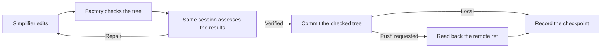

# How Factory works

Factory runs on the developer's machine. The target repository owns its instructions, checks and launch tools. The agent reads those instructions and chooses checks that demonstrate the requested behavior. Factory saves those checks as a contract and records what happened when they ran.

## Follow one check

1. **Discover.** `factory inspect` walks from the target paths to their repository root. It locates instruction files for the agent to read and extracts command candidates from supported manifests and project-declared checks. Each candidate includes its source and working directory. [Discovery and source identity](../skills/software-factory/scripts/workspace.py)
2. **Freeze.** `factory start` validates the contract and saves the claims under a new run ID. An external Python oracle is copied into the run, so editing the original later cannot weaken the saved expectation. [Contracts and evidence](../skills/software-factory/scripts/evidence.py)
3. **Observe.** `factory check` locks the workspace, fingerprints it, writes a pending attempt and runs the command. It captures output, exit status and timestamps, then fingerprints the workspace again. If the two fingerprints differ, Factory marks the attempt blocked. A temporary edit restored before the second snapshot is invisible to that comparison. [Process supervision](../skills/software-factory/scripts/supervision.py)
4. **Read back.** `factory status` compares the latest attempt for each claim to the current subject and checks the stored log digest. When a review is required, its report must also match the subject. A later outcome is a separate observation about that revision. [Behavioral tests](../tests/test_evidence.py)

In Git, the fingerprint includes HEAD, the index, tracked working files and unignored new files. A staged change still matters if an unstaged edit reverses it. A plain directory uses its filesystem contents. The journal and its digests share the local account's trust boundary. A check can also depend on ignored files, executables from PATH, or a script referenced by `argv`. For a service check, observe which build or account actually answered. [Consumer check guidance](../skills/software-factory/references/local.md#when-a-model-controls-the-outcome)

## Try Factory offline

Run this example offline from the Factory checkout. You need Git and Python, and you can use the checkout's `./factory` directly. The example creates a temporary project, checks its file, then edits the file so you can see what happens to the earlier result.

```sh
demo=$(mktemp -d)
mkdir "$demo/project"
printf 'ready\n' > "$demo/project/answer.txt"
cat > "$demo/contract.json" <<'JSON'
[{"id":"ready","expect":"answer.txt contains the line ready","argv":["grep","-Fx","ready","answer.txt"]}]
JSON

run=$(./factory start --repo "$demo/project" --task "Verify readiness" \
  --contract "$demo/contract.json" | python3 -c 'import json,sys; print(json.load(sys.stdin)["run"])')
./factory check "$run"                  # VERIFIED
printf 'pending\n' > "$demo/project/answer.txt"
./factory status "$run"                 # INCOMPLETE, claim STALE (exit 2)
./factory check "$run"                  # FAILED, claim FAIL (exit 1)
```

After you edit `answer.txt`, `./factory status "$run"` reports the earlier check result as `STALE` without rerunning the check. Run `./factory check "$run"` to check the current file. In this example, the new check fails because the file now says `pending`.

## Reach agreement between two models

`factory consensus design` asks two participants to compare alternatives and state what evidence would change their minds. Factory fills the two from different vendors when it can. In `diagnosis`, each must connect a proposed cause to the symptom or name the missing observation. A confirmed diagnosis may be inconclusive.

Each participant studies the same evidence before it sees the other's conclusion, which keeps the second opinion independent. The coordinator saves both opening reports, then alternates replies in the original sessions. Each proposal has a numbered turn, and agreement must acknowledge that specific turn. The discussion closes when both participants endorse the same proposal. An exhausted exchange budget produces an unresolved result with the last turn available for inspection. [Dialogue](../skills/software-factory/scripts/dialogue.py)

For example, if a deleted item still appears in a list, one participant might suspect a failed write and the other a stale client cache. A direct read of the stored item and a fresh list response can tell the two apart. Both can agree on that experiment while the cause is still unknown.

## Follow one simplification round



The coordinator pins the task, base, permitted paths, checks and number of rounds. Each round opens a fresh session that starts from the current branch. Its first user message is the exact versioned prompt. Requirements and the branch diff travel in a separate context channel, so you can inspect which prompt actually ran. [Prompt](../skills/software-factory/references/reconsider-from-first-principles.v1.txt)

The assessment resumes the editing session with read-only tools. A failing check requires repair even if the model accepts its work. A round can keep the code as it stands, and the selected number of rounds still runs. [Round coordinator](../skills/software-factory/scripts/rounds.py) · [Harness adapters](../skills/software-factory/scripts/harness.py)

**Harness turns.** The coordinator records each phase before starting a turn. The harness records the request and session. On resume, Factory uses those records to determine what happened to an interrupted call.

**Working files and Git trees.** Factory compares the working files before and after each check, before assessment, before committing and before confirming the checkpoint. The comparison uses the bytes on disk and treats symlinks as links. It can detect changes that Git normalization would hide. Staging can change the index while the working files stay the same, so Factory uses a temporary index to compute the expected tree and compares it with the committed tree. Older rounds without a saved fingerprint of the working files still use the Git tree check.

**Commit recovery and publication.** If Factory stops after a commit but before saving its receipt, it checks the parent, tree, branch and commit identity on resume. When the user requests publication, Factory records the push destination, verifies the expected remote head and reads it back after pushing. The explicit lease protects a remote branch that moved independently. [Git checkpoints](../skills/software-factory/scripts/checkpoints.py) · [Recovery and publication tests](../tests/test_rounds.py)

## Fill a role

Review, simplification and consensus are roles. Each role names the capabilities it needs, such as read-only turns, editing, a sandboxed shell and session resume. Each harness adapter declares the capabilities it provides and builds the restricted command for each kind of turn. A role can be filled only by a harness that declares everything the role needs, so a configuration mistake cannot hand an editing job to a harness with no sandbox. [Harness adapters](../skills/software-factory/scripts/harness.py)

To fill a role, Factory takes the flag for this run, then the approved project configuration, then the user's configuration, then a default for the machine. The default depends on which CLIs are installed and signed in and which one hosts the session. The reviewer default avoids the vendor that last changed the code. The result is a binding: the harness, the model, the source of the choice and any assurance it reduces. A run saves its bindings when it starts and reuses them on resume. [Role resolution](../skills/software-factory/scripts/roles.py) · [Roles, harnesses and models](../skills/software-factory/references/roles.md)

Model names stay out of the code. A role asks for a tier, and a [policy file](../skills/software-factory/scripts/defaults.toml) maps each tier to a model family for each harness. The adapter turns a family into the argument its CLI accepts. After the turn, the harness compares the model it requested with the model the CLI reports. A mismatch fails the turn, and a CLI that reports no model is recorded as such.

To support another harness, add one adapter class with its capabilities, its command for each turn and its result parser. Then add its tier families and its place in the default harness order to the policy file. [Role tests](../tests/test_roles.py)

## Boundaries and tradeoffs

| Boundary | Decision and consequence |
| --- | --- |
| Runtime | The CLI and skill ship together and use only Python's standard library. All state is local. Resuming a run needs its saved state and workspace. [Installation](../skills/software-factory/scripts/installation.py) |
| Processes | A supervisor owns the child process group and holds the workspace lock while it cleans up. Invocations on the same worktree share the lock when they use the same state directory. A service that deliberately detaches needs its own lifecycle handling. [Interruption tests](../tests/test_supervision.py) |
| Judgment | The local engine can verify a weak contract perfectly. Independent consumer checks, fresh reviews and later corrections expose different failures. [Live evaluation](../evals/qualify.py) |
| Independence | A reviewer or second participant from another vendor shares fewer blind spots with the author. With one harness, Factory runs the role anyway and records the reduced assurance in the receipt. [Roles](../skills/software-factory/references/roles.md#reduced-assurance) |
| Agreement | Two independent openings reduce anchoring. Agreement records a decision about one proposal and may conclude that the evidence is insufficient. [Dialogue](../skills/software-factory/scripts/dialogue.py) |
| Feedback | A later observation belongs to its original source revision. Changing a shared practice needs a scoped regression case and controls. [Outcome transfer experiment](../evals/outcome_transfer.py) |
